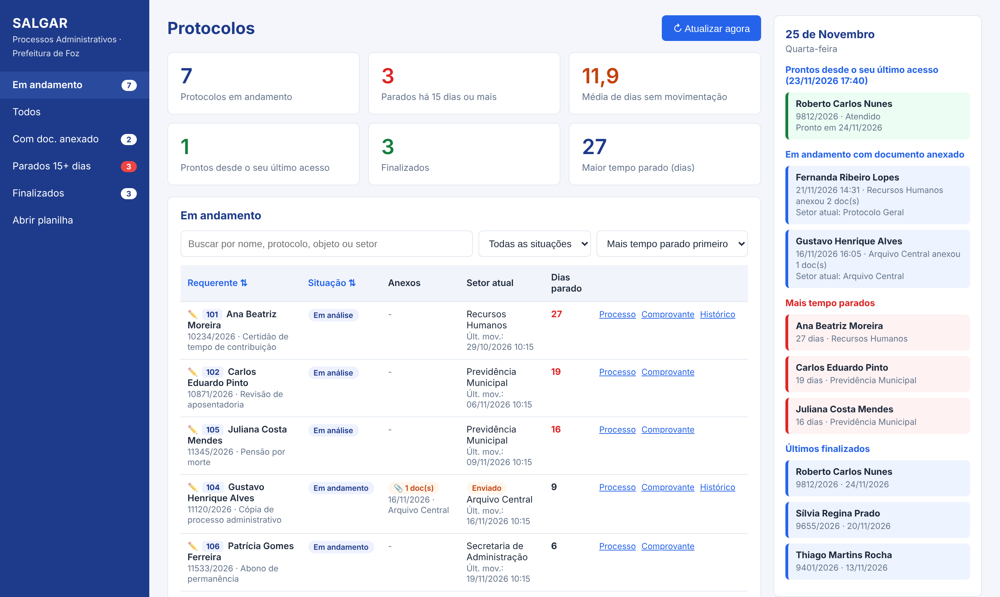
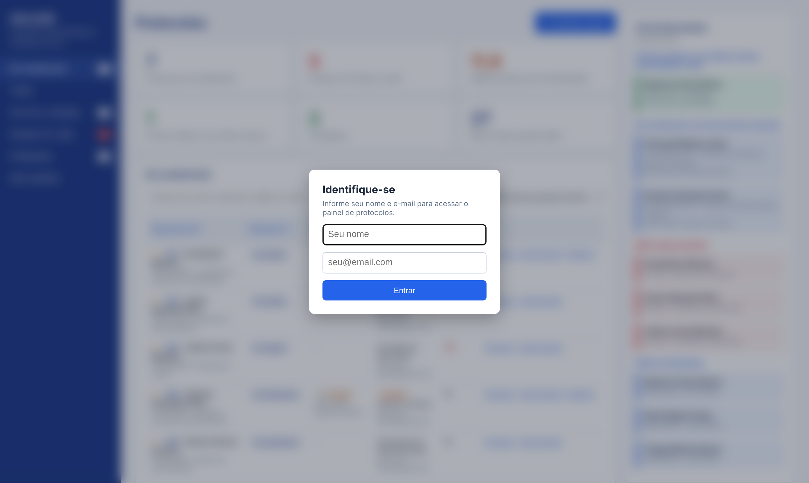
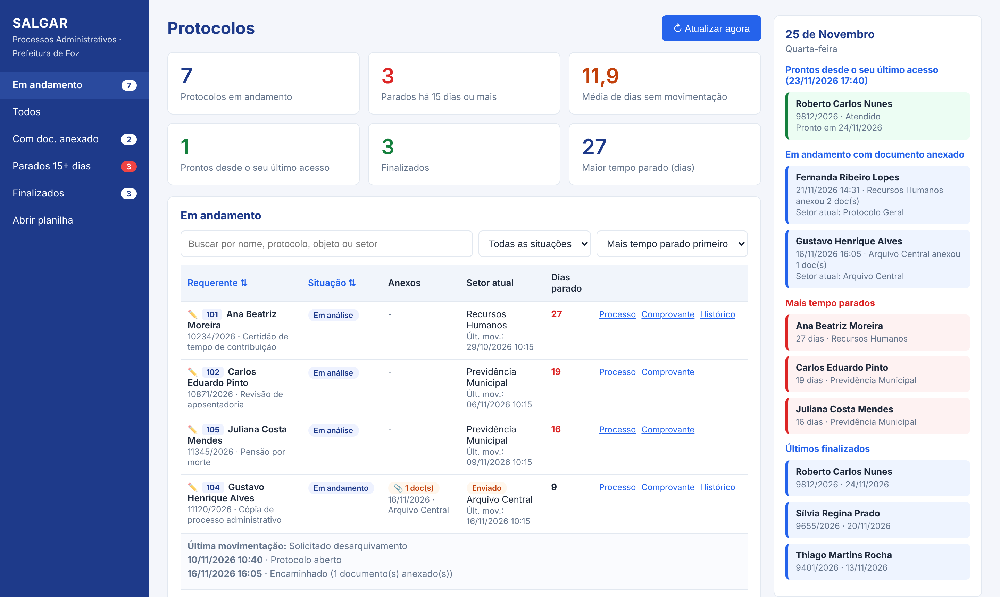
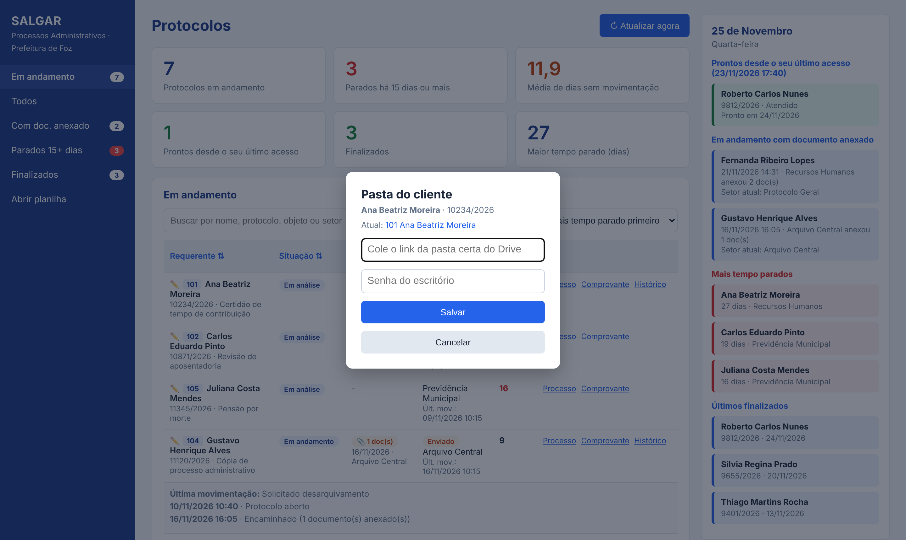
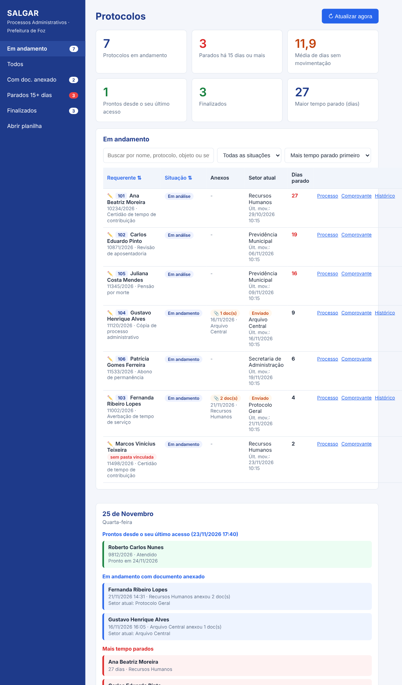

# Sistema de Protocolos Administrativos

**Por Damylla, estagiária de Direito na Salgar Advocacia (Foz do Iguaçu/PR)**

Este é um projeto de **automação** que eu idealizei e conduzi no escritório. Ele cobre o caminho inteiro de um pedido administrativo à Prefeitura: primeiro, um **agente** que prepara o requerimento do cliente do começo ao fim; depois, um **sistema** que acompanha sozinho cada protocolo, baixa os documentos que a Prefeitura anexa, avisa quando o pedido fica pronto e mostra tudo numa página que a equipe abre do computador ou do celular.

> Os nomes, números e datas que aparecem aqui são **fictícios**. O código publicado não tem dados de clientes nem identificadores do escritório.



---

## Onde tudo começou: um agente para os pedidos administrativos

No dia a dia do estágio eu cuidava dos pedidos administrativos dos clientes à Prefeitura: certidões de tempo de contribuição, revisões de aposentadoria, cópias de processo. Cada pedido tinha muitas etapas manuais e repetitivas, e qualquer dado errado podia atrasar tudo.

Por isso, **eu criei um agente**, com o Claude Code (Anthropic), que faz todo o processo de preparar o pedido. Eu ensinei o fluxo passo a passo e registrei as regras num manual e numa skill. Hoje, com um pedido simples, ele:

1. **cria a pasta do cliente** já numerada;
2. **busca os documentos mais recentes** do cliente (procuração, identificação, comprovantes) e copia para a pasta, sem nunca mover ou apagar os originais;
3. **confere a procuração palavra por palavra**, para garantir que ela tem os poderes especiais exigidos para pedidos administrativos;
4. **lê os documentos e extrai os dados** (nome, CPF, RG, data de nascimento, endereço, matrícula), aponta divergências e pergunta só o que falta, **sem nunca inventar um dado**;
5. **preenche o modelo de Requerimento Geral** da Prefeitura mantendo exatamente o layout, as linhas e o espaçamento do escritório;
6. gera o **PDF** e prepara a **assinatura digital**, sendo que o PIN do certificado é sempre digitado por uma pessoa, nunca pelo agente;
7. passa tudo por um **agente revisor**, que corrige erros de escrita e, se encontrar um erro de dado, **para tudo** e avisa antes da assinatura;
8. escreve a **mensagem pronta para o protocolo**, com os dados do cliente e o objeto do pedido.

Depois de protocolado, o pedido precisava ser acompanhado até a resposta. Foi aí que entrou a segunda parte do projeto.

## Depois: a planilha de acompanhamento

Para acompanhar os protocolos, **eu também tinha criado uma planilha**, com um script que lia o comprovante, consultava o portal da Prefeitura e marcava na agenda quando o pedido ficava pronto. Ela funcionou bem por um tempo, até que percebi que estava mostrando `#ERROR!` e, pior, **tinha parado de atualizar**. Em vez de só consertar, decidi dar um passo maior: *e se essa planilha virasse um mini sistema?*

## Como eu conduzi o projeto

Desenvolvi o sistema de acompanhamento em três dias, de 23 a 25/11/2026, em parceria com o **Claude Code**, a ferramenta de programação com inteligência artificial da **Anthropic**. Funcionou como um trabalho em dupla: eu definia o rumo, explicava como o escritório trabalha e o que precisava mudar, e o Claude transformava isso em código. A cada etapa eu testava no uso real, apontava o que não estava bom e decidia o próximo passo. Assim, o projeto foi crescendo a partir das necessidades que eu enxergava no dia a dia.

### 1. Primeiro, entender o que estava errado
Antes de construir qualquer coisa nova, investigamos por que a planilha tinha parado. O código ficava "dentro" da planilha, onde não dava para ler com facilidade. Então tive a ideia de mostrar o caminho pelo meu próprio navegador: com a extensão do Claude no Chrome, ele passou a ler e editar o código direto no editor do Apps Script. Descobrimos dois problemas diferentes, que vou explicar mais abaixo.

### 2. De planilha a sistema
Com a planilha funcionando de novo, propus o que eu realmente queria: uma **aba só para os protocolos finalizados**, para onde eles fossem sozinhos, e um **aviso de quem ficou pronto desde o último acesso**. Daí nasceu a ideia de uma **página própria**, com busca, filtros e destaques, e pedi que ela seguisse o visual dos outros sistemas do escritório. Também pedi que, quando um pedido termina, o comprovante fosse automaticamente para uma pasta **"Processos encerrados"**, e que essa pasta fosse criada uma vez só, e não uma nova a cada processo.

### 3. Deixar o sistema trabalhar sozinho
Perguntei se ele poderia atualizar assim que um comprovante novo entrasse na pasta. Chegamos a uma verificação a cada 15 minutos: quando entra um arquivo novo, o sistema lê o QR code e consulta o portal na hora. Depois quis entender como o código decide que um pedido está pronto, porque um protocolo já tinha sido enviado e o sistema não tinha avisado. Dessa dúvida surgiu a etiqueta "Enviado", que mostra quando a Prefeitura anexou documentos ao processo.

### 4. ⭐ O sistema reconhece e baixa sozinho os documentos da Prefeitura
Perguntei se o sistema poderia baixar os arquivos que a Prefeitura adiciona ao processo, já que antes era preciso entrar no portal, achar o documento novo, baixar, renomear e mover para a pasta certa, um por um. Agora, a cada atualização, ele **percebe sozinho quando a Prefeitura anexou um documento** (uma certidão, um despacho, uma resposta), **baixa e salva direto na pasta do cliente**, já numerado e sem duplicar. Num teste, percebi que ele baixava também o que nós mesmos tínhamos enviado como requerentes, e defini a regra de baixar só o que vem da Prefeitura.

### 5. Pensar em quem usa
Como outras pessoas do escritório também iam usar, pedi para saber **quem acessa** o sistema. A solução foi uma entrada simples, com nome e e-mail, sem precisar de login, e depois o **fundo desfocado** nessa tela, para ninguém ver os dados antes de se identificar. Pedi ainda que a página funcionasse **no celular**. Quando os anexos de um cliente foram parar na pasta errada por causa de nomes parecidos, sugeri um **ícone de lápis ✏️** para corrigir a pasta direto na página, em vez de criar mais uma coluna, e que aparecesse o **número da pasta** ao lado do nome.

### 6. Melhorias pensando no futuro
Pedi que o Claude olhasse o sistema "como um desenvolvedor" e sugerisse melhorias. Dessa conversa saiu o **resumo semanal**, que eu quis receber como evento na **agenda**, e não por e-mail, porque a agenda é o que a gente realmente consulta. Também pensei no crescimento: para a aba de acessos não lotar, ela passou a gerar **um relatório em PDF por mês** e só depois limpar as linhas. Para a planilha não chegar ao **limite do Google**, criamos um aviso **mensal**, e o arquivamento do histórico antigo só acontece com a minha autorização.

### 7. Garantir que continue funcionando
Por fim, quis ter certeza de que o sistema continuaria funcionando mesmo sem ninguém olhando. Daí vieram a aba "Saúde" e o agente de conferência, explicados nos itens 8 e 9. Também documentei tudo no **Obsidian**: visão geral, passo a passo do agente, código completo e esta história.

### 8. A automação, do comprovante ao aviso
O objetivo era que a equipe só precisasse **protocolar o pedido e salvar o comprovante na pasta**. Todo o resto acontece sozinho, nos servidores do Google: a cada 15 minutos o sistema procura comprovantes novos e lê o QR code; às 7h e às 13h consulta o andamento de todos os protocolos; a cada atualização baixa os documentos novos da Prefeitura; quando o pedido fica pronto, move para Finalizados, arquiva o comprovante e cria um lembrete na agenda; toda semana gera o resumo em PDF e todo mês o relatório de acessos. Cada rotina anota o resultado na aba **Saúde** (OK, ERRO ou ALERTA), que funciona como o "diário de bordo" do sistema.

### 9. O agente de conferência
A planilha original tinha parado de atualizar sem ninguém perceber, e eu não queria depender de alguém lembrar de conferir. Por isso pedi um **agente que confere o sistema toda semana, sozinho, na nuvem**. Ele lê a aba Saúde e as demais abas, confere se todas as rotinas rodaram, procura sinais de problema (fórmula com erro, QR code não lido, protocolo parado), olha o uso da página e sugere até 3 melhorias. No fim, salva um documento "Conferência do sistema" e cria um evento na agenda com o resultado (✅, ⚠️ ou ❌). A regra que defini: **o agente só lê e relata, nunca altera nada**. Qualquer correção é feita depois, com a minha aprovação.

## O que eu aprendi

**O erro que aparece nem sempre é o problema de verdade.** A planilha mostrava `#ERROR!` porque algumas fórmulas tinham sido gravadas com vírgula, e a planilha em português exige ponto e vírgula. Esse era o erro visível, mas não era o motivo de ela ter parado. O motivo real estava escondido: uma função que reorganizava as linhas quebrava sempre que o **último** protocolo da lista ficava pronto, e isso travava a atualização inteira. Se tivéssemos corrigido só as fórmulas, a planilha continuaria parada. Aprendi a investigar até achar a causa, e não só o sintoma.

**Às vezes o caminho é mostrar, e não explicar.** O código do Apps Script fica guardado dentro da planilha e não aparece no Drive, então o Claude não conseguia lê-lo. Em vez de copiar e colar trechos, liberei o acesso pelo meu navegador. Isso deixou o trabalho muito mais rápido e seguro, porque cada mudança era feita e conferida no lugar certo.

**Uma mudança só vale quando é publicada.** No começo eu alterava o sistema e a página continuava igual. Descobri que, no Apps Script, a página web só muda quando se cria uma **nova versão** da publicação. Isso virou uma regra fixa do projeto: toda mudança termina com uma nova versão e um teste.

**Nada se apaga sem antes copiar e conferir.** Como o sistema lida com dados de clientes, estabeleci que nada seria apagado de forma automática sem garantia. O histórico de acessos só sai da planilha depois que o relatório em PDF do mês foi gerado e conferido, e o arquivamento de movimentações antigas sempre mostra o que vai fazer e pede confirmação antes de mexer em qualquer linha.

**Um sistema precisa conseguir se observar.** Automação que falha em silêncio é pior do que não ter automação, e foi exatamente o que aconteceu com a planilha original. Por isso criamos a aba "Saúde": cada rotina anota se terminou bem, com erro ou com alerta. É a partir dela que o agente semanal confere o sistema, e assim qualquer problema aparece logo, em vez de passar dias sem ninguém perceber.

---

## Próximos passos

A próxima evolução é trazer as **pastas dos clientes para dentro do sistema**: conseguir visualizar as pastas e criar uma pasta nova direto pela página, sem precisar sair para o Drive. Essa ideia já estava no radar, mas decidimos focar primeiro em deixar o acompanhamento estável e completo, para que o projeto tivesse a sua **primeira versão entregue e funcionando** no dia a dia do escritório.

---

## O que o sistema faz

| Função | Como funciona |
|---|---|
| Lê o **QR code** do comprovante que entra na pasta do Drive | Verificação a cada 15 minutos |
| Consulta o **andamento no portal** da Prefeitura | 2 vezes por dia e pelo botão "Atualizar agora" |
| Separa os **finalizados** e move o comprovante para "Processos encerrados" | Automático |
| Cria **lembrete na agenda** quando o pedido fica pronto | Google Agenda |
| **Baixa os anexos** que a Prefeitura junta ao processo | Direto para a pasta do cliente |
| **Página web** com busca, filtros, parados há 15+ dias e prontos desde o último acesso | Funciona no computador e no celular |
| Registra **quem acessou** e arquiva os acessos por mês em PDF | Aba Acessos |
| **Resumo semanal** em PDF | Evento na agenda |
| Aba **Saúde**: cada automação registra OK, ERRO ou ALERTA | Base do agente de conferência |
| **Agente de conferência** semanal na nuvem | Toda semana, sem depender de computador ligado |
| Aviso de **tamanho da planilha** e arquivamento do histórico antigo | Mensal, sempre com confirmação |

## Telas

| Entrada (fundo desfocado) | Histórico do protocolo |
|---|---|
|  |  |

| Trocar a pasta vinculada (pede senha) | No celular |
|---|---|
|  |  |

Para ver a página funcionando, baixe e abra [`demo/index.html`](demo/index.html) no navegador. Ela roda em **modo demonstração**, com dados inventados, e não se conecta a nada. A [planilha de exemplo](Planilha%20de%20exemplo%20-%20Protocolos%20(dados%20ficticios).xlsx) mostra a estrutura usada, também com dados fictícios.

## Como funciona por dentro

```
Comprovante (PDF/imagem) ──► Pasta no Drive ──► verificação a cada 15 min
                                                     │ lê o QR code
                                                     ▼
Portal da Prefeitura ◄── atualização (7h, 13h e pelo botão)
                                                     │
              ┌──────────────────────────────────────┼─────────────────────────┐
              ▼                                      ▼                         ▼
  Planilha (Protocolos, Finalizados,      Agenda (lembretes e          Pasta do cliente
  Movimentações, Acessos, Saúde)          resumo semanal)              (anexos baixados)
              │
              ▼
  Página web ◄── equipe, no computador ou no celular
              │
              ▼
  Aba Saúde ──► agente de conferência semanal (nuvem)
```

```
src/Codigo.gs        código completo do Apps Script (identificadores trocados por marcadores)
src/appsscript.json  configurações do projeto: fuso, serviços e permissões
demo/index.html      a página em modo demonstração
docs/prints/         capturas de tela
```

As bibliotecas de leitura de QR code (jsQR 1.4.0, jpeg-js 0.4.4 e pako 2.1.0) são de terceiros e não estão incluídas.

**Tecnologias:** Google Apps Script · Google Sheets · Drive · Agenda · HtmlService · Claude Code, da Anthropic (desenvolvimento assistido por IA e agente de conferência)

---

## Contato

**Damylla**, estagiária de Direito na Salgar Advocacia
- E-mail: damylla.limaa@gmail.com
- LinkedIn: [linkedin.com/in/damylla-lima](https://www.linkedin.com/in/damylla-lima)
